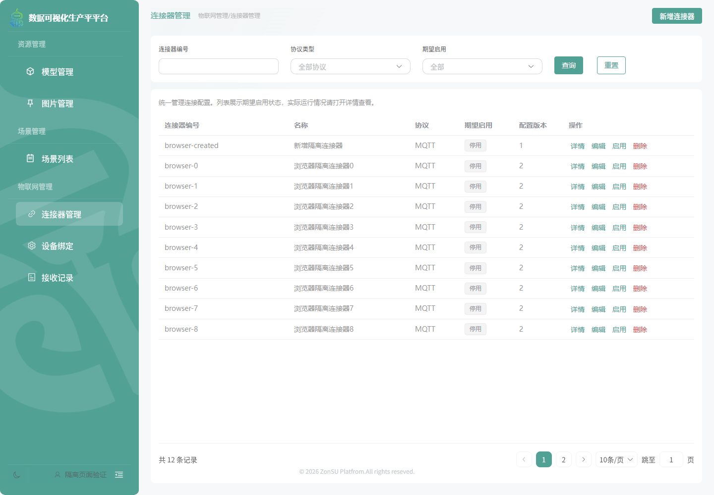
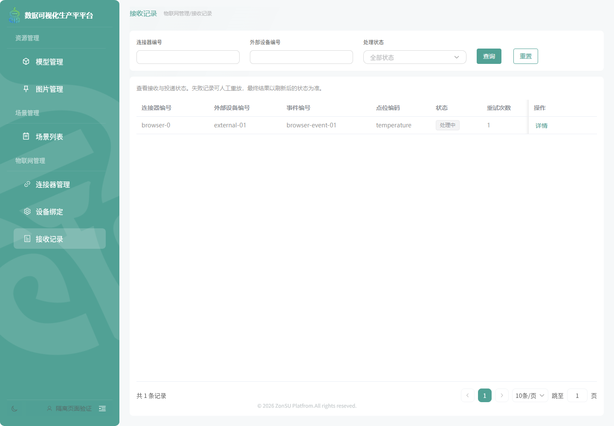

# IoT 正式网页实现证据

日期：2026-11-10。任务：IOT-M2-IMPL-01。已在现有Vue管理端接入三个正式页面；独立HTML原型保留为历史设计，不再作为页面实现证据。

- 正式路由：`/iotManage/connectors`、`/iotManage/bindings`、`/iotManage/messages`。
- 标准授权菜单递归渲染，名称/层级/顺序/图标来自后台；只有已编译组件白名单且具备query权限才可进入，按钮和处理器分别检查写权限。原资源/场景导航保持兼容。
- IOT-UI-02补充：物联网顶层复用资源/场景相同的分类标题，授权入口直接展开；更深目录保留折叠。浏览器检查增加三类标题同级及顶层不作为可折叠菜单的断言，截图已更新。
- 连接器：分页筛选、详情/编辑、版本冲突保留表单、启停、保存前MQTT结构校验、已保存连接测试及按需运行观测。
- 设备绑定：真实数据库分页接口、映射JSON编辑与类型提示；绑定沿用最后保存生效，未声称具备乐观锁。
- 接收记录：分页筛选、详情及失败重放；提示“已提交，需刷新确认”，不把异步提交当最终发布。

## 已执行检查

`pnpm vitest run src/auth/__tests__ src/servers/manual/iot/__tests__ src/views/iotManage/__tests__`：9套69项通过。覆盖菜单白名单/身份清理、内嵌菜单补读失败关闭及迟到结果、标准路径/权限/编号精度、版本冲突、字段白名单、映射JSON及日期格式。

`pnpm build`：类型检查与生产构建通过。存在工程既有大分块告警，本批未升级依赖或重构编辑器分包。

`node scripts/iotManagementBrowserSmoke.mjs`：正式Vue页面的[13项浏览器检查](browser-checks.json)通过，覆盖菜单、详情/租约、长编号、缺凭据测试结果、版本冲突、新增、筛选/空状态、映射校验、重放状态、故障重试、1024宽度、只读按钮及直接地址拒绝、身份菜单隔离。菜单/表单/请求层为真实代码；后端传输使用脚本替身，仅操作隔离浏览器内样本。

## 验证边界

未在实际业务入口部署或应用菜单授权，未通过真实认证/网关操作IoT业务库。后端另有独立MySQL的实际SQL/租户分页验证，见[后端证据](../../../../../Server/jtyf-cloud/docs/evidence/iot-m2-20261110/README.md)。未使用真实Broker/Kafka、设备或Unity；不能把以上测试当线上闭环验收。
