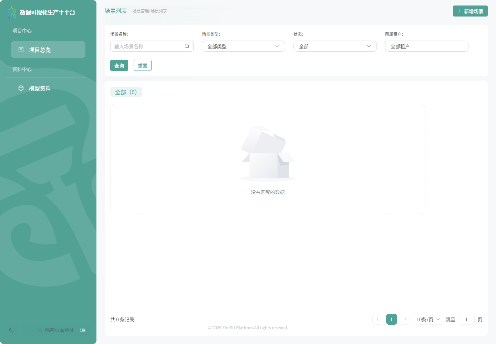

# 管理导航统一验证

日期：2026-11-10。任务：NAV-01。代码已本地实现，实际环境菜单/角色/套餐配置与前端部署尚未执行。

## 方案与产物

资源、场景和物联网均从当前身份的授权menus树读取名称、层级、顺序及可见性，由同一组件渲染，三类顶层继续共用分类标题。七个已编译页面共用白名单和首次/站内准入；模型/图片与查询权限求交集，模板保留运营端边界，场景沿用登录及服务端租户/对象授权。

缺失菜单、读取失败或没有可用页面时进入 `/management/access`，不挂载资源/场景业务页，不回退静态全量入口。该页可刷新权限；身份快照更新时侧栏同步重建，退出清理。标准后台复用已有权限接口；参考资料和可信宿主消息可提供可选菜单，缺失时需补充配置，不能从角色猜测。

实现见 `src/auth/managementNavigation.ts`、`src/layout/ManagementNavigationMenu.vue`、`src/views/manageShared/ManagementAccess.vue` 及现有App/路由/认证适配。软件设计和准确组件标识见[统一设计](../../design/02_管理导航统一设计.md)。

## 已执行验证

- 先新增统一导航用例，确认缺少实现模块导致失败后再实现。
- `pnpm vitest run src/auth/__tests__ src/servers/manual/iot/__tests__ src/views/iotManage/__tests__`：11套76项通过，覆盖三个模块、权限交集、模板限制、未知/重复组件、隐藏父级、身份订阅/退出、参考菜单、可信宿主来源及迟到菜单。
- `pnpm build`及最终`pnpm type-check`通过；保留既有分块过大告警，未升级框架或依赖。
- 设置 `IOT_BROWSER_OUTPUT_DIR=docs/evidence/nav01-20261110` 后运行 `node scripts/iotManagementBrowserSmoke.mjs`，正式Vue页面的[16项浏览器检查](browser-checks.json)通过。包含后台改名/排序生效、删除图片菜单后直接地址拒绝且不发图片列表请求、空菜单不循环跳转及重新授权恢复。
- `TWOD_SMOKE_BASE_URL=http://127.0.0.1:5187/dts node scripts/twoDFrontendBrowserSmoke.mjs`通过：[二维回归](two-d-regression.json)。107个组件加载、配置/远程绑定、分组/显隐撤销、按钮事件、编辑保存重开、发布预览及管理路由均通过，没有页面错误/模块失败/Unity连接。本次只向原隔离身份补充菜单合同，保留脚本原有其他差异。
- 差异、UTF-8、链接及菜单清单核验见后端[验证记录](../../../../../Server/jtyf-cloud/docs/evidence/nav01-20261110/verification.json)。

## 迁移边界

以上浏览器后端均为传输替身，未向真实业务库写数据，不能称真实网关/账号联验。发布前须通过系统菜单接口配置/复用[资源及场景清单](../../../../../Server/jtyf-cloud/db/system/editor-management-menus.json)及现有[IoT清单](../../../../../Server/jtyf-cloud/wx-module-iot/db/iot-management-menus.json)，为目标角色和租户套餐分配目录/页面及适用查询权限。

现有早期测试初始化只插入模型按钮权限，不能视为拥有页面导航；部署应先补实际菜单再切换前端。没有后台菜单时会显示明确配置提示，不会自动开放所有入口。现有服务端业务鉴权保持原规则。
