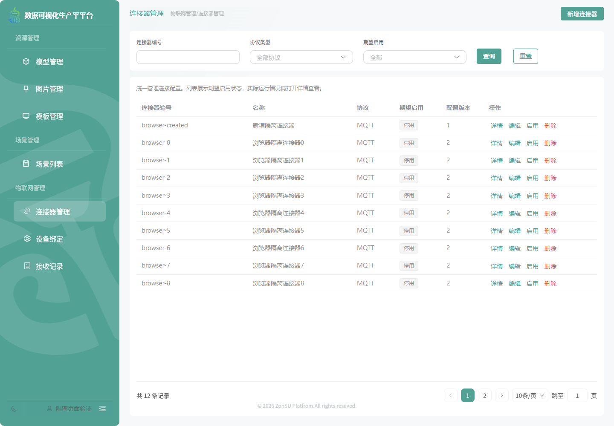

# 原管理目录层级恢复

日期：2026-11-10。任务：NAV-02。用户指出NAV-01直接透传后台任意目录，并使用改名测试截图，偏离原有业务分类。本批恢复原有一二级目录，不撤销统一后台授权。

- 资源管理：模型管理、图片管理、模板管理。
- 场景管理：场景列表。
- 物联网管理：连接器管理、设备绑定、接收记录。

前端遍历可信授权树，保留隐藏父级、组件白名单、查询权限、模板平台限制及去重检查；将授权页面归入已确认业务模块，不把应用包装目录或第三级目录原样放进侧栏。分类和页面显示名恢复原定义，模块内页面顺序仍随后台授权树。缺失授权时不生成页面，空菜单仍使用恢复提示。

先新增用例复现旧实现两项失败，再修正投影。11套77项定向测试通过；正式Vue页面17项浏览器检查和生产构建结果见本目录记录。浏览器仍采用隔离传输替身，不代表真实后端或已上线。

当前截图使用原业务目录及明确的隔离样本，避免用改名测试图误导界面交付：

实际环境菜单/角色配置与部署尚未执行。本轮只修正前端展示投影，未修改后端业务、真实授权或数据库。
